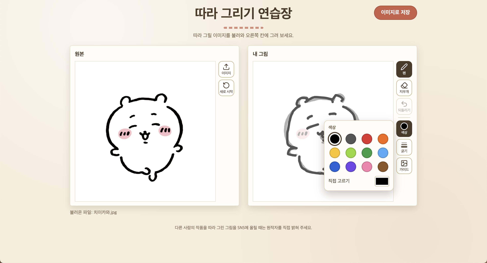
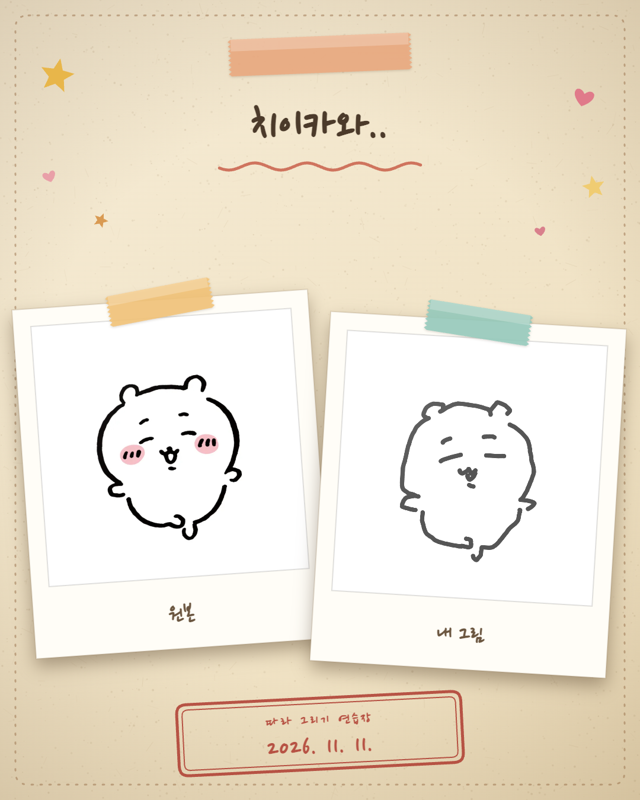

# 따라 그리기 연습장

원본 이미지를 보면서 흐린 가이드 위에 따라 그리고, 원본과 내 그림을 한 장의 SNS용 이미지로 저장하는 웹앱입니다. HTML 파일 하나로 동작하며 로그인, 서버, 인터넷 연결이 필요 없습니다.

  
  

<!--  -->
<!--  -->

## 사용법

1. `따라그리기_v4.html`을 브라우저(Chrome 등)에서 엽니다.
2. 왼쪽 ‘원본’ 칸에 JPG·PNG 이미지를 선택하거나 끌어다 놓습니다.
3. 오른쪽 ‘내 그림’ 칸에 흐린 가이드를 따라 그립니다. 오른쪽 도구 막대에서 펜, 지우개, 되돌리기, 색상, 굵기, 가이드 농도를 바꿀 수 있습니다.
4. 오른쪽 위 ‘이미지로 저장’을 누르고 제목을 정하면 1080×1350 PNG로 저장됩니다.

그리던 그림은 이 브라우저에 자동 저장되어 다시 열어도 이어서 그릴 수 있습니다. 처음부터 다시 하려면 ‘새로 시작’을 누르세요.

## 파일

| 파일                 | 설명                    |
| -------------------- | ----------------------- |
| `따라그리기_v4.html` | 최종 버전               |
| `기획서.md`          | 최종 버전에 맞춘 기획서 |
| `제작검증기록.md`    | 제작·테스트·수정 기록   |

사용한 AI: Claude (Anthropic), Claude Sonnet 5.5
